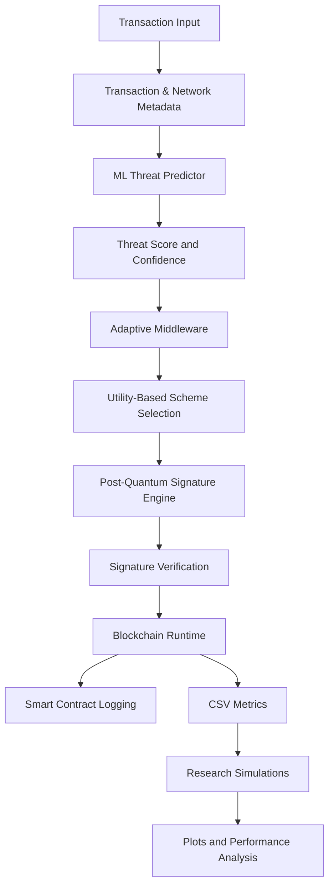

<div align="center">

# Adaptive PQ Blockchain

### Intelligent Post-Quantum Cryptography for Adaptive Blockchain Security

**ML-Driven Threat Assessment · Adaptive Signature Selection · Smart Contract Auditing**

<br/>


<br/><br/>

*A research prototype exploring how blockchain systems can adapt their cryptographic signature strategies according to transaction risk, urgency, and network conditions.*

</div>

---

## Overview

Traditional blockchain systems generally rely on a predefined cryptographic signature scheme. However, the emergence of quantum computing motivates research into cryptographic approaches designed to withstand quantum attacks.

**Adaptive PQ Blockchain** explores an adaptive approach to post-quantum blockchain security. Instead of applying the same signature scheme to every transaction, the system evaluates transaction characteristics and network conditions to select a cryptographic strategy using an adaptive middleware layer.

The project integrates:

- **Machine Learning:** Estimates transaction threat levels using transaction value, network congestion, and verification latency.
- **Adaptive Cryptography:** Selects among available post-quantum signature schemes using a utility-based decision mechanism.
- **Blockchain Integration:** Connects the Python runtime to an Ethereum-compatible network through Web3.py.
- **Smart Contract Logging:** Records transaction metadata, selected schemes, threat information, and verification-related results.
- **Research Simulations:** Generates visualizations and analytical metrics for studying cryptographic trade-offs, adaptive behavior, and simulated gas costs.

The goal is to investigate the trade-off between security-oriented decisions and operational efficiency in a blockchain environment.

---

## System Architecture



### How it works

1. **Transaction generation:** The runtime generates simulated transactions or can attempt to retrieve transactions from a connected Ethereum-compatible network.
2. **Threat assessment:** The ML component evaluates transaction value, network congestion, and verification latency.
3. **Adaptive selection:** Middleware evaluates available signature schemes using security, latency, signature-size, and transaction-priority considerations.
4. **Signing and verification:** The selected cryptographic backend signs the transaction payload, which is then verified by the runtime.
5. **Blockchain logging:** Transaction information is written to CSV and can be submitted to the configured `PQRegistry` smart contract.
6. **Research analysis:** Simulation modules generate visualizations and calculate modeled performance and gas-cost comparisons.

---

## Post-Quantum Cryptography

The `pq_crypto_engine` module provides signing and verification adapters through the `liboqs-python` / `oqs` interface.

| Scheme | Cryptographic family | Purpose in the prototype |
|---|---|---|
| FALCON | Lattice-based | Alternative signature backend |
| DILITHIUM | Lattice-based | Post-quantum signature backend |
| OV | Multivariate | Alternative signature backend |
| SPHINCS+ | Hash-based | Alternative signature backend |

The runtime initializes the configured scheme objects and passes them to the adaptive middleware.

### Adaptive selection strategy

The middleware maintains local algorithm profiles representing:

- Security preference
- Relative signing-latency cost
- Signature-size cost

It combines these profiles with the predicted threat score, transaction value, urgency, and congestion to calculate a utility cost for available schemes.

A priority override can select SPHINCS+ when the threat score exceeds a configured threshold or the transaction value exceeds a configured limit.

**Important:** These profiles and utility values are application-defined modeling parameters, not standardized cryptographic security measurements. The project explores adaptive selection; it does not introduce a new cryptographic primitive.

---

## ML-Based Threat Assessment

The `adaptive_middleware/ml_threat_predictor.py` module uses a Random Forest classifier.

### Input features

| Feature | Description |
|---|---|
| Transaction value | Value associated with the transaction |
| Network congestion | Estimated congestion level |
| Verification latency | Verification-time input |

The classifier estimates probabilities across four threat categories:

- 🟢 **LOW**
- 🟡 **MEDIUM**
- 🟠 **HIGH**
- 🔴 **CRITICAL**

These probabilities are mapped to numeric weights to produce a threat score. The predictor also calculates a confidence value.

The current implementation trains on a small, hardcoded synthetic dataset. Its scores should therefore be treated as experimental outputs, not as a validated real-world threat detector.

---

## Blockchain Integration

The blockchain components connect the Python research runtime to a local Ethereum-compatible node.

### Smart contract: `PQRegistry`

The Solidity contract supports:

- Recording transaction identifiers and cryptographic scheme names
- Storing threat and latency metadata
- Recording verification-related results and timestamps
- Emitting transaction logging events and security alerts
- Retrieving records and the total record count

The Python `OnChainLogger` integrates the contract with Web3.py and also maintains a CSV record of transaction metrics.

The contract currently implements simplified, scheme-specific verification behavior for demonstration purposes. It does **not** perform complete on-chain verification of the post-quantum signature schemes.

---

## Research & Evaluation

The `simulations/runner.py` module contains three research simulations.

### 1. Quantum Cryptanalysis & Efficiency

Generates illustrative plots exploring:

- ECC and RSA vulnerability scenarios
- Modeled quantum-attack effects
- Security-margin comparisons
- Illustrative throughput and security-efficiency trade-offs

### 2. Adaptive Behavior Analysis

Uses transaction metrics to visualize:

- Cryptographic scheme selection frequency
- Threat categories versus selected schemes
- Distribution across cryptographic families

### 3. Gas Economics & Efficiency

Calculates modeled comparisons involving:

- Signature-size assumptions
- Estimated gas units associated with signature data
- Cumulative gas-cost comparisons
- Simulated throughput and throughput-to-cost ratios

These experiments provide a framework for exploring the design space. Numerical outputs depend on the model assumptions and should not be interpreted as independently benchmarked production performance.

---

## Tech Stack

| Component | Technologies |
|---|---|
| Core runtime | Python |
| Cryptographic integration | `liboqs-python` / `oqs` |
| ML threat prediction | scikit-learn, NumPy |
| Blockchain connectivity | Web3.py |
| Smart contracts | Solidity |
| Local blockchain development | Hardhat |
| Data analysis | Pandas, NumPy |
| Visualizations | Matplotlib, Seaborn |
| Metrics | CSV-based logging |

---

## Project Structure

```text
adaptive-pq-blockchain/
│
├── adaptive_middleware/
│   ├── controller.py
│   └── ml_threat_predictor.py
│
├── blockchain_core/
│   ├── runtime.py
│   └── onchain_logger.py
│
├── pq_crypto_engine/
│   └── signatures/
│       ├── dilithium.py
│       ├── falcon.py
│       ├── ov.py
│       └── sphincs_plus.py
│
├── contracts/
│   └── PQRegistry.sol
│
├── ignition/
│   └── modules/
│
├── benchmarks/
├── simulations/
│   └── runner.py
│
├── evaluation/
├── threat_engine/
├── test/
├── logs/
│
├── main.py
├── hardhat.config.js
├── package.json
└── test_oqs.py
```

---

## Getting Started

### Prerequisites

Install or configure the following:

- Python 3.10 or a compatible version for the selected dependencies
- Node.js and npm
- Hardhat and its project dependencies
- A local Ethereum-compatible JSON-RPC node
- A compatible `liboqs` installation and Python bindings

### 1. Clone the repository

```bash
git clone https://github.com/sameerpalkar04/adaptive-pq-blockchain.git
cd adaptive-pq-blockchain
```

### 2. Install the JavaScript dependencies

```bash
npm install
```

### 3. Compile the smart contracts

```bash
npx hardhat compile
```

### 4. Start a local blockchain

Open a terminal and run:

```bash
npx hardhat node
```

Keep the node running. The Python runtime defaults to:

```text
http://127.0.0.1:8545
```

### 5. Set up the Python environment

Create and activate a virtual environment:

```bash
python -m venv .venv
```

macOS / Linux:

```bash
source .venv/bin/activate
```

Windows:

```powershell
.venv\Scripts\Activate.ps1
```

Install the Python dependencies used by the runtime and simulations:

```bash
pip install numpy pandas matplotlib seaborn scikit-learn web3
```

Install and configure the compatible `liboqs` native library and Python bindings separately, following the official [liboqs-python documentation](https://github.com/open-quantum-safe/liboqs-python).

> **Note:** The repository does not currently include a complete Python dependency manifest. Additional dependencies may be required depending on your environment and installed `liboqs` version.

### 6. Deploy the smart contract

Compile the contract, then deploy `PQRegistry` to your local Hardhat network using an appropriate Hardhat Ignition deployment module or deployment script.

Ensure the deployed contract address matches the address configured in `blockchain_core/onchain_logger.py` before running on-chain logging.

### 7. Run the research suite

The entry point accepts a transaction count:

```bash
python main.py 100
```

If no count is provided, the current default is 2,000:

```bash
python main.py
```

**Before running:** `main.py` currently passes `num_tx` to simulation methods whose definitions in `simulations/runner.py` do not accept that parameter. Align those calls with the method signatures before expecting the full research suite to complete.

The runtime and simulations are designed to write metrics and generate plots under `logs/` and `evaluation/plots/`.

---

## Scope & Limitations

This project is a research prototype intended for experimentation and learning.

- **Synthetic threat data:** The ML classifier uses a small, predefined training dataset and has not been established as a production-grade threat detector.
- **Simplified contract verification:** The Solidity contract uses demonstration logic rather than complete post-quantum signature verification.
- **Local execution:** The default configuration targets a local RPC endpoint; external network integration requires additional configuration.
- **Modeled performance:** Some throughput, cryptanalysis, signature-size, and gas comparisons are based on predefined assumptions or synthetic scenarios.
- **Security assurance:** The project has not been established as a production-ready blockchain protocol or independently audited security solution.

Do not use the prototype to secure real financial transactions or production assets without substantial redesign, rigorous testing, and independent security review.

---

## Future Improvements

Potential directions for extending the project include:

- Training and evaluating the threat model on representative transaction data.
- Adding reproducible benchmarks across cryptographic schemes.
- Implementing complete signature verification and explicit key-management policies.
- Improving contract integration and verification of logged results.
- Adding automated tests for adaptive selection, cryptographic correctness, and failure handling.
- Exploring configurable policies for balancing security, latency, and transaction cost.

---

## 👨‍💻 Author

**Sameer Palkar**

Software Engineer | Backend Development | Blockchain & Post-Quantum Cryptography

- [GitHub](https://github.com/sameerpalkar04)
- [LinkedIn](https://www.linkedin.com/in/sameer-palkar-9707b9286/)

---

<div align="center">

**Exploring adaptive cryptography for a quantum-resilient blockchain future.**

</div>
